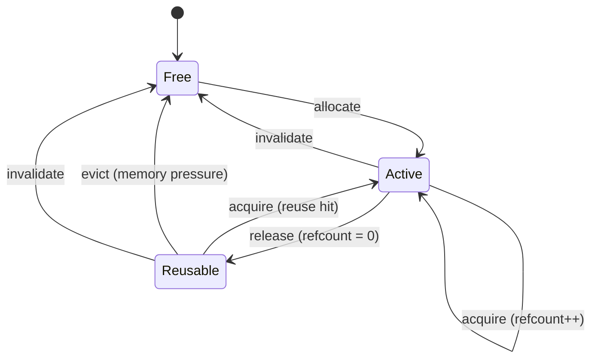

# MiniCache

> A rigorously-verified **KV-cache policy core** in Rust — the retention/eviction and
> prefix-reuse logic that sits beneath LLM inference, built spec-first and proven
> against independent reference models.

[](https://github.com/gauravmahajan2007-ops/minicache/actions/workflows/ci.yml)
[](LICENSE)

---

## What is it?

MiniCache started as a minimal in-memory TTL key-value cache — the first end-to-end
test of the **Hermes Systems Lab** methodology — and grew into the software layer that
decides *which KV blocks to keep, evict, and reuse* in an LLM serving stack (the same
problem NVIDIA's TensorRT-LLM `KvCacheRetentionConfig` solves: priority + duration-TTL +
prioritized-LRU).

It is **not** a full inference engine and holds no tensor data itself. It is the
hardware-agnostic *policy core*: small, correct, and exhaustively tested, ready to be
driven by — or bound into — a real engine.

## The Systems Lab method

Every subsystem is built the same way:

```
spec → capabilities → invariants → independent reference model
     → implementation → property-based tests → repair workflow
```

Each subsystem has an **independent oracle** (written from the spec, not the code), and a
property test replays thousands of generated operation sequences asserting exact agreement.
Every bug class is demonstrated with a deliberately faulty fixture, caught by a real failing
test, saved as a counterexample, fixed, and regression-guarded.

## Architecture

Four subsystems compose into the policy core. On a reuse **hit**, data flows top to bottom:

```mermaid
flowchart TD
    T["request tokens"] --> PI["<b>PrefixIndex</b><br/>longest-prefix lookup<br/><i>radix trie · block_key</i>"]
    PI -->|matched block ids| BM["<b>BlockManager</b><br/>retention / eviction policy<br/><i>priority · duration-TTL · LRU</i>"]
    BM -->|block id (acquire / allocate)| POOL["<b>KvPool</b><br/>block byte storage<br/><i>CpuPool · CudaPool</i>"]
    POOL -->|KV bytes| OUT["attention / decode"]
```

The TTL cache `MiniCache` is the foundation the other three build on.

## Block lifecycle



Interactive HTML diagrams (self-contained, no build step) live in
[`docs/diagrams/`](docs/diagrams/index.html): **architecture**, **block lifecycle**, and
**reuse flow (hit vs miss)**.

## Subsystems

| Module | Role | Key semantics |
|---|---|---|
| `MiniCache` (`src/lib.rs`) | TTL key-value foundation | absolute expiry, overwrite-reset, idempotent delete |
| `BlockManager` (`src/block_manager.rs`) | retention / eviction policy | priority 0–100 (default 35), duration-TTL revert, prioritized-LRU, never evict active |
| `PrefixIndex` + `block_key` (`src/prefix_index.rs`, `src/block_key.rs`) | prefix-reuse lookup | radix trie, longest-prefix, FNV-1a 64 block keys |
| `KvPool` (`src/pool.rs`, `src/cuda_pool.rs`) | device byte storage | `CpuPool` (tested) + `CudaPool` (feature `cuda`, type-checked) |

## Usage

```rust
use minicache::{BlockManager, CpuPool, KvPool, PrefixIndex, Retention};

// Device storage (bytes) + the policy manager + the prefix index.
let mut pool = CpuPool::new(64, 128);          // 64 blocks × 128 bytes
let mut blocks = BlockManager::with_capacity(64);
let mut index = PrefixIndex::new();

// A request arrives with a token sequence.
let tokens = [101u32, 202, 303];

// Longest-prefix lookup: which cached blocks can be reused?
let (matched, reusable) = index.longest_prefix(&tokens);
for block in reusable {
    blocks.acquire(block);                    // reusable -> active
    let mut kv = vec![0u8; 128];
    pool.read_block(block, &mut kv).unwrap(); // reload KV, skip recompute
}

// Release a finished block with a retention policy (priority 80, 30s TTL).
blocks.release(block_id, Retention::new(80, Some(30_000.0)).unwrap()).unwrap();
```

See [`SPEC_POOL.md`](SPEC_POOL.md) and the per-subsystem specs for the full contract.

## Verification

`cargo test` — **60 passed, 0 failed** (no GPU required; all time is simulated):

- **2,000 property-based cases** across four subsystems, each checked against its own
  independent reference model.
- `cargo clippy --all-targets -- -D warnings` and `cargo fmt --check` are clean and run in CI.
- A repair workflow is demonstrated per subsystem (faulty fixture → red → counterexample →
  fix → green); the committed counterexamples live in [`counterexamples/`](counterexamples/).

```sh
cargo test                              # full suite (60 tests)
cargo check --features cuda             # type-check the GPU CudaPool (link/run needs CUDA)
```

## Documentation

- [`SPEC.md`](SPEC.md) / [`SPEC_RETENTION.md`](SPEC_RETENTION.md) / [`SPEC_PREFIX.md`](SPEC_PREFIX.md) / [`SPEC_POOL.md`](SPEC_POOL.md) — behavioral specifications
- [`DESIGN.md`](DESIGN.md) / [`DESIGN_RETENTION.md`](DESIGN_RETENTION.md) / [`DESIGN_PREFIX.md`](DESIGN_PREFIX.md) / [`DESIGN_POOL.md`](DESIGN_POOL.md) — capabilities, invariants, acceptance criteria
- [`REPORT.md`](REPORT.md) / [`REPORT_RETENTION.md`](REPORT_RETENTION.md) / [`REPORT_PREFIX.md`](REPORT_PREFIX.md) / [`REPORT_POOL.md`](REPORT_POOL.md) — end-to-end reports with real evidence
- [`KVCACHE_INTEGRATION_PLAN.md`](KVCACHE_INTEGRATION_PLAN.md) — how MiniCache maps to NVIDIA's KV cache, and the approved scope
- [`docs/diagrams/`](docs/diagrams/index.html) — interactive HTML/SVG diagrams

## License

[MIT](LICENSE) © 2026 Gaurav Mahajan
